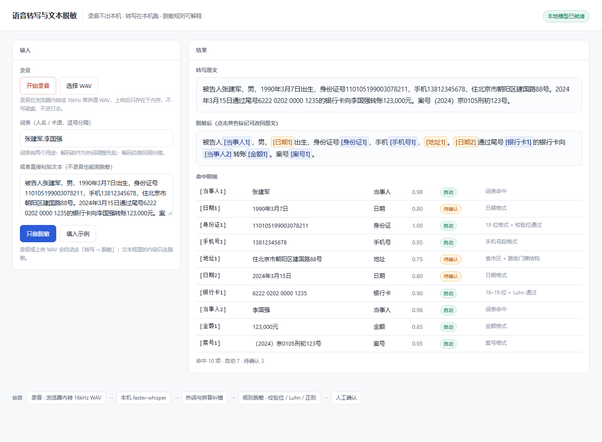

# 语音转写与文本脱敏 · 本地运行

一个可以直接跑的最小实现：**录音 → 本机转写 → 词表纠错 → 敏感信息识别与替换 → 人工确认**。
全程离线，音频不写磁盘、不进日志、不上传。



```bash
python run.py          # 起服务并打开 http://127.0.0.1:8765
```

打开即有一次自动运行的示例，不用点任何按钮。**没有装模型也能用**——文字脱敏是纯标准库实现，粘贴文本就能测。

---

## 为什么要做这个东西

法律场景里的语音转写有个绕不开的矛盾：录音里全是当事人姓名、身份证号、住址、案号，
而现在的转写服务几乎都要把音频传到云上。这不是"注意保密"能解决的问题，是架构问题。

所以这个实现把三件事绑在一起：转写在本机、脱敏在本地规则层、原文不进任何外部服务。
下面记的是几个具体的技术选择，以及为什么这么选。

## 一、转写：为什么自己解 WAV，不交给 PyAV

faster-whisper 内部用 `av.open()` 解码音频，PyAV 一换版本就抛
`open() got an unexpected keyword argument 'metadata_errors'`。这个坑在真实项目里很常见，
但让使用者去降级 PyAV 是把工程债推给别人。

这里改成用标准库 `wave` 解 WAV，直接喂 `float32` 数组给模型：

```python
samples = np.frombuffer(raw, dtype="<i2").astype(np.float32) / 32768.0
model.transcribe(samples, language="zh", ...)
```

代价是只接受 16kHz / 单声道 / 16bit——但浏览器端录完音就是要转成这个格式的，
约束反而让格式校验更明确（会直接告诉你"当前是 44.1kHz / 2 声道"）。

## 二、GPU 不可用时自动降级，而不是报错

`ctranslate2` 能检测到 CUDA，**但 cuBLAS 的 DLL 要到推理那一刻才加载**。
所以 `WhisperModel(...)` 构造成功不代表能跑——实测在缺 `cublas64_12.dll` 的机器上，
构造不报错，第一次 `transcribe` 才炸。

降级逻辑因此必须放在推理处，而不是加载处：

```python
except Exception as e:
    if attempt == 0 and gpu_issue and _BACKEND.startswith("cuda"):
        model = _switch_to_cpu()   # 换 CPU + int8 重试一次
        continue
```

实测：12 秒中文音频，CPU int8 用时 **4.39 秒（实时率 0.37）**，界面上会直接标出
`cpu/int8（GPU 不可用，已降级）`。慢，但能用——比弹一个 DLL 缺失错误有用。

## 三、热词救不了同音人名，所以要两层补救

`whisper-small` 认不出专有名词。我的做法是分两层，而不是只调一个参数：

**解码前**：`initial_prompt` 注入词表，改的是模型的先验。

**解码后**：拼音编辑距离纠错，改的是结果。

```python
correct_with_lexicon("被告人张珊", ["张山"])   # → 被告人张山
```

比拼音而不是比字符，是因为要抓的错都是同音不同字。「张山 / 张珊」字符级相似度只有 0.5，
阈值再低也不会命中；拼音序列 `['zhang','shan']` 则完全相同。

**这一层也有边界**：只在相似度 ≥ 0.88 且字面不同时才替换，宁可漏改，不能错改——
错改会把人名改成另一个人，这在法律文书里比留个错字严重得多。

实测这段真实录音（12 秒景点讲解）的输出：

```
可以先找找彩虹明镜的提客   ← 应为「题刻」
再看看湖中的观音像和亭字   ← 应为「亭子」
```

热词注入了「明镜湖」但识别成「明镜」——**这恰好说明热词对短词的牵引力有限**，
真正要解决还得靠解码后的词表 + 上下文。这也是我认为这个功能该有的分层。

## 四、脱敏：规则优先，模型靠后

身份证、手机号、银行卡这类东西"有格式、有校验位"，正则 + 校验位能做到零误判，
而且能解释「为什么匹配」——这一点在合规场景里比准确率还重要，因为律师要签字。

所以：

| 类型 | 依据 | 置信度 |
|---|---|---|
| 身份证 | 18 位格式 + GB 11643 校验位 | 1.00 自动 |
| 银行卡 | 16–19 位 + Luhn 校验 | 0.90 自动 |
| 手机号 / 邮箱 / 案号 | 格式 | 0.95 自动 |
| 姓名（词表命中） | 外部当事人名单 | 0.98 自动 |
| 姓名（无词表） | 线索词 + 姓氏表 | **0.60 待确认** |
| 地址 | 省市区 + 路街门牌结构 | 0.75 待确认 |

**姓名启发式被刻意做成低置信度。** 中文人名没有边界、没有校验位，靠姓氏表硬猜必然误杀。
所以它只输出 0.6，界面上标黄等人点确认——这不是没做完，是有意的产品边界。

校验位在这里不是炫技，是拦截器：把 `6222 0202 0000 1235` 改成 `...1234`，Luhn 不通过，
系统就不替换（见评测用例「校验位-拦截」）。宁可漏一个，不要错改一个。

## 五、评测结果

`python eval/run_eval.py` 会重新生成 `eval/REPORT.md`。

| 指标 | 结果 |
|---|---|
| 召回率 | **100%**（20 / 20 个标注实体） |
| 误替换率 | **0%**（0 个替换不在标注内） |
| 单条耗时 | 0.1 ms（纯规则，无模型调用） |

8 条用例覆盖：混合刑案片段、Luhn 拦截、**纯法条文本零误杀**（《劳动合同法》第八十七条那段，
不该有任何替换）、双身份证并存、无词表姓名、邮箱、金额、日期不误吞。

口径说明：漏检是脱敏产品的致命伤（漏一个身份证整份材料就不能外发），
误替换是可用性问题（把"第八十七条"当金额替换掉，律师会立刻弃用）。两个都得报。

**但这是自建的 8 条小样本，不是基准测试。** 真实文书上的表现会明显下降，
下面的局限里写了原因。

## 六、已知局限（这些我没解决）

1. **日期一律替换，分不清"出生日期"和"案发日期"。** 前者是敏感个人信息，后者是案件事实，
   不该脱。正确做法是结合上下文判断，或用「出生」这类线索词限制范围。
2. **人名只认百家姓里的常见姓。** 少数民族姓名、复姓、外文译名基本识别不了；
   化名（"张三""李某"）本来就不该替换，但现在会被姓氏启发式误伤。
3. **没有做"脱敏后是否还能反推"的检验。** 把身份证替换成 `[身份证1]` 只是遮挡，
   不等于匿名化——个保法第 73 条里这是两件事，产品对外表述的口径要非常小心。
4. **回填没有做权限控制。** 现在的 mapping 只在单次请求的内存里，够 demo 用，
   但真实产品需要"谁能回填、回填要不要留痕"的设计。
5. **没有真正的多人协作与审计日志。** 谁改过哪一条、什么时候确认的，都应该留痕。

## 七、目录

```
app/asr.py        本地转写：WAV 解码、懒加载、GPU→CPU 降级、拼音纠错
app/redact.py     脱敏：规则表、校验位、词表、置信度、占位符
app/server.py     零依赖 HTTP 服务（标准库），音频走 raw body
web/index.html    单页界面：录音、上传、脱敏对照、点击改回原文
eval/             评测用例与报告生成
run.py            一键启动
```

## 八、环境变量

| 变量 | 作用 |
|---|---|
| `VRD_MODEL_DIR` | faster-whisper 的 ct2 模型目录；不放则自动找 HF 缓存 |
| `VRD_DEVICE` | 强制 `cuda` 或 `cpu`；不设则先试 GPU 再降级 |
| `VRD_CUBLAS_DIR` | 自带 cuBLAS 的目录，设了才能用 GPU |
| `VRD_THREADS` | CPU 线程数，默认 4 |

## 九、依赖

核心（脱敏 + 服务 + 界面）**零第三方依赖**，标准库即可运行。

可选：

```bash
pip install faster-whisper   # 语音转写，不装则只有文字脱敏
pip install pypinyin         # 同音纠错，不装则退化为字符级相似度（基本无效）
pip install opencc-python-reimplemented   # 繁转简
```

刻意不用 FastAPI：这个 demo 的第一目标是"在任何一台机器上打开就能看"，
少一层依赖就少一个跑不起来的理由。FastAPI 在别的项目里用得很多。

---

上一版做在景区导览产品里（本机 faster-whisper 的第一次落地），
这套代码是把它抽出来，换成法律文书的场景。
